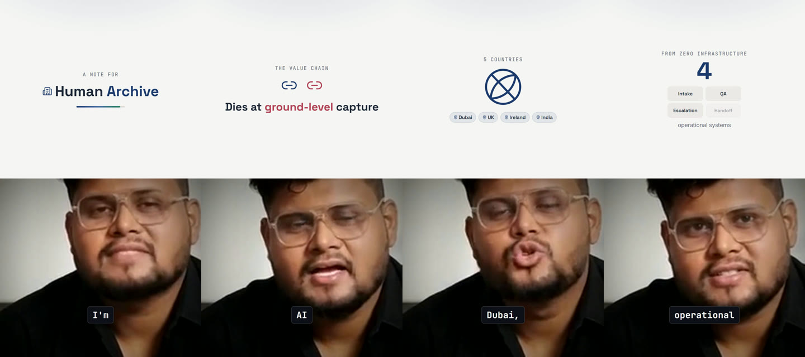
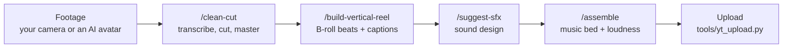

# YouTube Shorts AI Editor

**Record your face (or generate an AI avatar). Claude Code builds the rest of a 60–90 second vertical Short.**

Half real-image B-roll, half you, with word-by-word captions, tasteful sound effects and a soft music bed.
Every top-half beat is code ([Remotion](https://remotion.dev) / React) synced to the exact word you say.
No video editor. No screen recording.



<sub>Four frames from a real 107-second Short made with this repo. The bottom half is AI-avatar footage; everything in the top half
is generated code. Captions follow every spoken word.</sub>

[](LICENSE)


---

## What you get

- **The split-frame Short format.** Your face stays in the bottom half the whole time. The top half swaps between B-roll beats
  timed to your narration. Captions never touch your face. ([spec](docs/SHORTS-FORMAT.md))
- **Real assets, not clip-art.** When you say a company, a city, an app or a job posting, the beat shows a **real photo or a real
  screenshot** of it (web search + live page capture), animated with a Ken Burns push or a simulated screen recording.
  Icons are the fallback for abstract ideas only. ([guide](docs/REAL-ASSETS-BROLL.md)) *Note: the two reference reels in
  `examples/` were built before this policy and use icon-style beats. The tooling and rules are in place; re-making a reel with
  real assets is the natural first exercise.*
- **Sound that was designed, not sprinkled.** A shared SFX library (whooshes, pops, risers, a camera-shutter snap for real-photo
  reveals), a per-video cue sheet you approve before anything is mixed, and a music bed ducked under your voice.
  ([guide](docs/SOUND-AND-MUSIC.md))
- **A hard quality bar.** Every step has a gate: stills you must look at, A/V sync checks, a transcript diff on the rendered cut,
  audibility measured in dB, and a final loudness pass to −14 LUFS.
- **Works with a camera or an AI avatar.** Both example Shorts were built from AI-avatar footage, including the awkward case of a
  watermarked free-tier export. ([guide](docs/AVATAR-FOOTAGE.md))
- **One prompt, whole video.** Copy-paste prompts for every stage. ([prompt cookbook](docs/PROMPTS.md))

## The format

```
┌────────────────────────────── 1080 × 1920 ──────────────────────────────┐
│  TOP HALF (0–960)       B-roll beats: real photo / real screenshot /      │
│                         stat / diagram, swapped by a beat schedule        │
│                         timed to your words                               │
├───────────────────────────────────────────────────────────────────────────┤
│  BOTTOM HALF (960–1920) YOU. Cropped face footage, on screen the whole    │
│                         runtime                                           │
│                              ┌────────┐                                   │
│  CAPTIONS (always on top)    │  word  │  one active word, below the chin  │
│                              └────────┘                                   │
└───────────────────────────────────────────────────────────────────────────┘
```

## How it works



| # | Step | Skill | What happens |
|---|---|---|---|
| 1 | **The cut** | `/clean-cut` | AssemblyAI transcribes, Claude authors `cuts.json` from the transcript, out comes a clean master plus a word-level `edited-transcript.json` |
| 2 | **The Short** | `/build-vertical-reel` | Face crop, split-frame shell, one bespoke scene per beat, word-by-word captions, rendered and checked frame by frame |
| 3 | **The sound** | `/suggest-sfx` | A cue sheet synced to words and visual beats, audited by you, then mixed |
| 4 | **The mix** | `/assemble` | The soothing music bed under your voice, then a two-pass loudness normalization to −14 LUFS |
| 5 | **Upload** | `tools/yt_upload.py` | Checks itself for ghost speech and A/V drift, then uploads as a private draft |

Also included: `/brand-setup` (make it look like *your* channel), `/clean-audio`, `/fake-screencast`, `/make-tsx`,
`/vidtsx-2d-generator`, and the long-form extras `/packaging` and `/thumbnail`. Full walk-through: [docs/PIPELINE.md](docs/PIPELINE.md).

## Quickstart

**Requirements:** [Claude Code](https://claude.com/claude-code), Python 3.10+, Node 18+, `ffmpeg` and `ffprobe` on your PATH.

```bash
git clone https://github.com/raisaksham377-bot/youtube-shorts-ai-editor
cd youtube-shorts-ai-editor

python -m venv venv
venv/Scripts/python -m pip install -r requirements.txt     # Windows  (macOS/Linux: ./venv/bin/pip)
venv/Scripts/python -m playwright install chromium         # one-time, for real-page capture

cd remotion && npm install && npm run gen && cd ..         # build the Remotion registry

cp .env.example .env                                       # then add your keys (see docs/SETUP.md)
claude                                                     # open Claude Code in this folder
```

**See the format before you shoot anything:**

```bash
cd remotion && npm run studio        # open the "ShortsFormatDemo" composition
```

**Then talk to Claude Code:**

> set up my brand
>
> *(then use the master prompt in [docs/PROMPTS.md](docs/PROMPTS.md): footage, topic, tone, and "run the whole Shorts pipeline,
> stop at each audit gate")*

Step-by-step install for Windows, macOS and Linux, including every API key and what works without it: [docs/SETUP.md](docs/SETUP.md).
Prefer Hinglish? [docs/QUICKSTART-HI.md](docs/QUICKSTART-HI.md).

## What it costs (the honest part)

The code is free and open source. The models and services are not, and they are *your* keys in *your* `.env`.
Prices and free tiers below were checked in September 2026 and change often; always confirm on the vendor's page.

| Service | Used for | Notes |
|---|---|---|
| **Claude Code** | driving the whole pipeline | paid plan or API credits |
| **AssemblyAI** | transcription (step 1) | free tier is enough to try it |
| **ElevenLabs** | SFX library growth, music beds, optional voice isolation | paid. The library already ships with 36 SFX clips and 6 music beds, so you only need a key to *add* sounds. `/clean-audio` also has a local RNNoise method that needs no key |
| **Footage source** | your camera, or an AI-avatar tool | free-tier avatar exports carry a watermark and tight limits. See [docs/AVATAR-FOOTAGE.md](docs/AVATAR-FOOTAGE.md) for what we hit and a crop that removes it |
| **Playwright** | capturing real web pages | free, local (Chromium download, about 115 MB) |
| **Gemini** | thumbnails (long-form only) | optional, not used for Shorts |
| **YouTube** | upload | free, OAuth, see [tools/yt_upload_SETUP.md](tools/yt_upload_SETUP.md) |

Optional Claude connectors (HeyGen, OpenArt, VidIQ, Canva, Figma, Notion and others) are described in
[docs/MCP-CONNECTORS.md](docs/MCP-CONNECTORS.md), including which one produced the example footage (HeyGen) and which ones we only
explored.

## What's different from the upstream project

This repo is a **Shorts-focused fork** of [claude-youtube-editor](https://github.com/hassancs91/claude-youtube-editor) by
Hasan Aboul Hasan (MIT), which targets long-form YouTube. Added here:

- the `/build-vertical-reel` skill and the split-frame Short format, plus reusable caption and top-card components
- the **real-assets-over-icons** B-roll policy, `RealPhotoKenBurns`, live page capture, and the `camera-snap` sound
- the `/assemble` step (music bed + final loudness), which upstream tools referenced but never shipped
- CPU-encoder fallbacks for machines without an NVIDIA GPU
- two complete reference Shorts, a self-contained demo, and a field-tested troubleshooting guide

The exact list, file by file: [docs/CHANGES-FROM-UPSTREAM.md](docs/CHANGES-FROM-UPSTREAM.md).

## Repo map

```
.claude/skills/   the skills — this is where the editor actually lives
tools/            Python: transcribe, cutlib, render_cuts, verify_cut, gen_sfx / mix_sfx, gen_music / mix_music,
                  capture_web, clean_voice, yt_upload … plus the local cut-editor UI (tools/editor/)
remotion/         the Remotion project: src/lib/ (kit, browser, screencast), src/shots/<video>/, brand tokens
media/library/    reusable assets: 36 SFX clips, 6 music beds, logos, a placeholder photo
media/projects/   media for ONE video (git-ignored by default for captures and footage)
examples/         two reference Shorts + building blocks + thumbnail prompt recipes   → examples/README.md
docs/             the guides                                                           → table below
brand.md          the style contract every skill reads (ships as a template; run /brand-setup)
videos/           your videos live here. Ships empty on purpose
```

## Docs

| Guide | Read it when |
|---|---|
| [SETUP](docs/SETUP.md) | installing, API keys, first-run checks |
| [PIPELINE](docs/PIPELINE.md) | you want every step, command and quality gate |
| [SHORTS-FORMAT](docs/SHORTS-FORMAT.md) | you want to understand or change the split-frame layout |
| [REAL-ASSETS-BROLL](docs/REAL-ASSETS-BROLL.md) | you want real photos and screenshots in your B-roll |
| [SOUND-AND-MUSIC](docs/SOUND-AND-MUSIC.md) | you want to know where the background sound comes from and how to control it |
| [AVATAR-FOOTAGE](docs/AVATAR-FOOTAGE.md) | your talking head is an AI avatar, or a watermarked export |
| [MCP-CONNECTORS](docs/MCP-CONNECTORS.md) | you want to connect more tools to Claude |
| [PROMPTS](docs/PROMPTS.md) | you want copy-paste prompts |
| [TROUBLESHOOTING](docs/TROUBLESHOOTING.md) | something broke (we hit most of these ourselves) |
| [CHANGES-FROM-UPSTREAM](docs/CHANGES-FROM-UPSTREAM.md) | you want to know exactly what this fork changed |

## Credits and license

- **Upstream:** [hassancs91/claude-youtube-editor](https://github.com/hassancs91/claude-youtube-editor) by Hasan Aboul Hasan, MIT.
  The cut pipeline, the Remotion kit, the SFX/music tooling and most skills are his work.
- **Shorts edition:** Saksham. Vertical format, real-asset policy, `/assemble`, examples and docs.
- **License:** MIT, see [LICENSE](LICENSE). Both copyright notices are kept. Bundled SFX and music clips were generated with
  ElevenLabs (by the upstream author, plus `camera-snap` by the Shorts-edition author) and are redistributed; per-clip provenance
  is in `media/library/*/catalog.json`. Product logos
  (Claude, VS Code) belong to their owners.

If this saved you time, star the repo and tell me which step you want to go deeper on.
