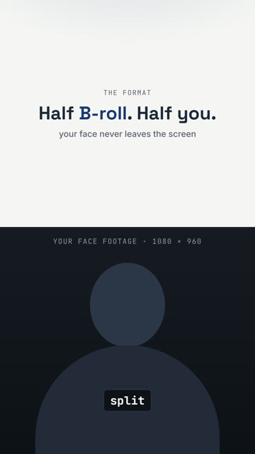
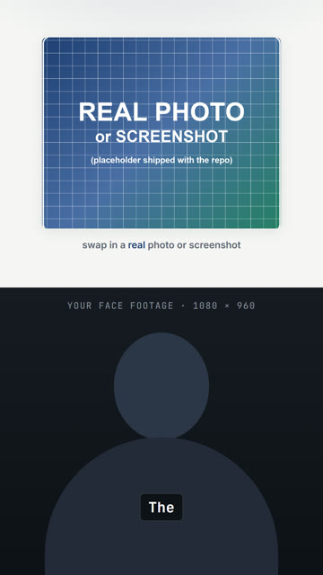
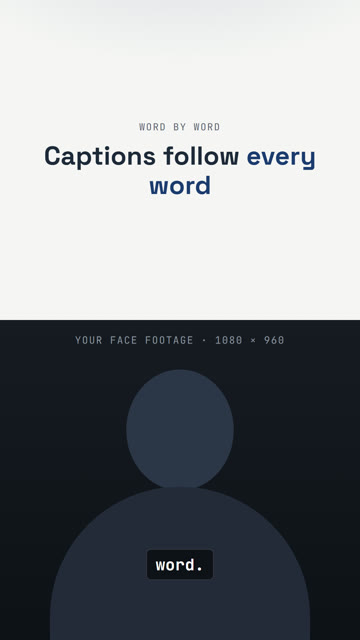
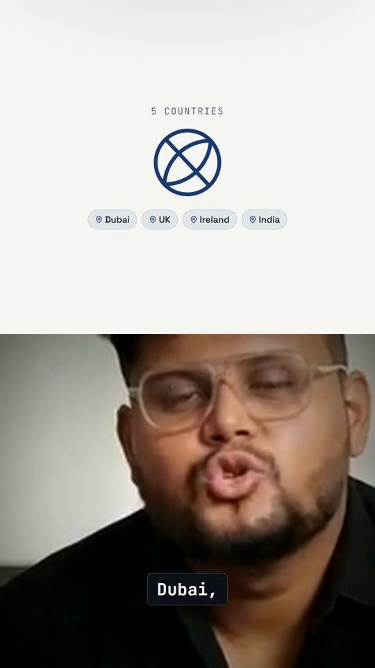

# The Shorts format: split-frame, face always on screen

A 1080×1920, 30 fps vertical video. The bottom half is **you**, for the entire runtime. The top half is a sequence of B-roll
beats timed to what you say. Word-by-word captions sit over the bottom half and never cover your face.

The premise is what separates this from the long-form `/make-tsx` model: long-form cuts *away* from the talking head for concept
beats. Here the face never leaves the screen, so every graphic has to share the frame with it.

```
AbsoluteFill 1080 × 1920
 ├─ background layer                       full canvas (BrandBg)
 ├─ bottom-half video  top:960, h:960      OffthreadVideo of your face, cropped
 ├─ top-half scene     h:960               ONE scene at a time, swapped by a beat schedule
 └─ WordCaptionOverlay                     always last, so captions survive every beat
```

See it running with no footage: `cd remotion && npm run studio` → `ShortsFormatDemo`
([source](../remotion/src/shots/shorts-demo/ShortsFormatDemo.tsx)). Two complete reels (70 s and 107 s) are in
[examples/shorts](../examples/shorts/).

<p>
  
  
  
  
</p>

<sub>Left to right: three frames of the footage-free `ShortsFormatDemo` (text card, real-photo beat, caption beat), and one frame
from a real Short (a globe beat with location chips over the presenter).</sub>

## 1. Getting the face into the bottom half

You have to show a 1080×960 window of your footage. There are two ways to get there.

### A. Offset crop (source is already a full-bleed vertical shot)

Transcode to comp-native (1080×1920, 30 fps, 8-bit H.264), place it oversized in a clipped box, and shift it up:

```tsx
<div style={{ position: 'absolute', left: 0, top: 960, width: 1080, height: 960, overflow: 'hidden' }}>
  <OffthreadVideo src={staticFile(FOOTAGE)}
    style={{ position: 'absolute', top: CROP_OFFSET, left: 0, width: 1080, height: 1920 }} />
</div>
```

`CROP_OFFSET` is usually negative. The mapping from a row of your footage to the final canvas is:

```
canvas_y = 960 + (video_local_y − CROP_OFFSET)
```

**Find the number by looking, not by arithmetic.** Render a still at a candidate offset; if the hairline is cut off, push the offset
more negative; if there is dead space above the head, pull it back toward 0. Two or three iterations is normal. One of our reels
settled on `−140`, which put the hairline at the top of the window. Yours will differ, so measure it.

### B. Pre-crop (source has bars, a watermark, or the face is small in a wide frame)

Crop and scale with ffmpeg *before* Remotion, to exactly the 1080×960 window, then fill the box with no offset:

```bash
ffmpeg -i master.mp4 -vf "crop=W:H:X:Y,scale=1080:960:flags=lanczos,fps=30" -c:v libx264 -pix_fmt yuv420p -c:a copy \
       media/projects/video-1/master-comp-native.mp4
```
```tsx
<OffthreadVideo src={staticFile(FOOTAGE)} style={{ position: 'absolute', top: 0, left: 0, width: 1080, height: 960 }} />
```

Choose `W:H` with the **same aspect as the window** (1080:960 = 9:8), otherwise the face is visibly stretched. This is how the second
example was built, because its source was a 16:9 picture letterboxed inside a 9:16 canvas with a watermark across the whole frame.
The full story, including how the safe window was found, is in [AVATAR-FOOTAGE.md](AVATAR-FOOTAGE.md).

## 2. Captions: the safe zone

`WordCaptionOverlay` (in `remotion/src/lib/kit.tsx`) shows one active word at a time, popping in on its `edited-transcript.json`
timestamp. `bottomPad` is the distance from the canvas bottom to the pill's bottom edge; the default `180` puts the pill at
roughly `canvas_y` 1660–1740, **below the chin, on the collar line**.

The classic bug is a pill that lands on the eyes: it looks fine on one short word and fails on a long one. Before calling a
`bottomPad` done:

- render stills at the **shortest** and the **longest** word in the transcript (narrowest and widest pill);
- render stills at several different beats, not just one;
- look at each. The pill must be under the jaw for all of them.

Platform UI (account handle, like/comment rail, caption stack) overlaps the top ~10–14% and bottom ~18–22% of the frame on most
apps. Keep key text and the wordmark out of the top zone. If you raise `bottomPad` to clear the bottom rail, re-verify it still
misses your face.

## 3. The beat scheduler

Top-half scenes are plain components driven by a **local** frame. They do not call `useCurrentFrame()` themselves and are never
wrapped in their own `<Sequence>`:

```tsx
type Card = { startFrame: number; endFrame: number; scene: 'intro' | 'chain' | 'globe' | /* … */ string };

const CARDS: Card[] = [
  { startFrame: 0,    endFrame: 240,  scene: 'intro' },
  { startFrame: 750,  endFrame: 945,  scene: 'chain' },
  // …
];

const frame = useCurrentFrame();
const active = CARDS.find((c) => frame >= c.startFrame && frame < c.endFrame);
if (active) {
  const localFrame = frame - active.startFrame;
  const holdFrames = active.endFrame - active.startFrame;
  // dispatch: <ChainScene frame={localFrame} holdFrames={holdFrames} />
}
```

Why local frames: a full-screen `<Sequence>` cutaway would hide your face, and shared chrome components (browser frames, status
bars) that read the global frame fire their entrance at the wrong time once the scene is driven by a local one. Pass
`appearAt={active.startFrame}` to such components, or hand-roll a smaller version.

**Every window comes from real word times.** `frame = round(ms × 30 / 1000)`. Take the word's `start` from
`work/edited-transcript.json`; never eyeball it. Entrances follow the house fade: `[0, 10, hold−10, hold] → [0, 1, 1, 0]`.

A second appearance of the same scene is just a second row in `CARDS`.

## 4. Scenes: what goes in the top half

Order of preference, per beat:

1. **A real photo or screenshot of the thing named**, with Ken Burns motion (`RealPhotoKenBurns`) or a simulated screen recording.
   See [REAL-ASSETS-BROLL.md](REAL-ASSETS-BROLL.md).
2. **A real captured page**, framed in `WebBrowserFrame` or replayed with `/fake-screencast`. Confine it to `height: 960`
   and scale coordinates for a 1080×960 region; do not crop a 1080×1920 mockup to its top half.
3. **A motion graphic** for abstract ideas: a stat counting up, a three-step reveal, a chain breaking. Size it generously. In a
   1080×960 region big and confident beats small and restrained.
4. **A text card** (`TopCard`) for plain statements.

## 5. Pacing and length

Target 60–90 seconds. Our two examples ran 70 s and 107 s, and the longer one is the less typical Short. Roughly one beat per 5–6
seconds of narration worked well (the 107 s reel has 18 beats and 24 sound cues). Split long sentences across two beats rather than
holding one card for 15 seconds.

## 6. Render checklist

- `npx tsc --noEmit`, then proof stills at each beat's entrance and mid-hold.
- A **unique composition `id`** per Short. `gen-registry` skips a duplicate id with nothing but a warning line, so a copied file can quietly
  vanish from the registry. Look for `DUPLICATE id` in the `npm run gen` output.
- `node scripts/render-all.mjs <Id> --scale=1` (scale 1: this is the final delivery size, not a compositing layer).
- `ffprobe`: video stream duration equals the composition length.

Next: [REAL-ASSETS-BROLL.md](REAL-ASSETS-BROLL.md) · [SOUND-AND-MUSIC.md](SOUND-AND-MUSIC.md).
